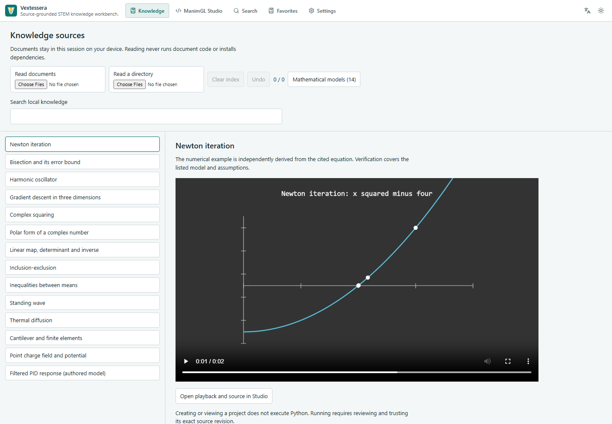
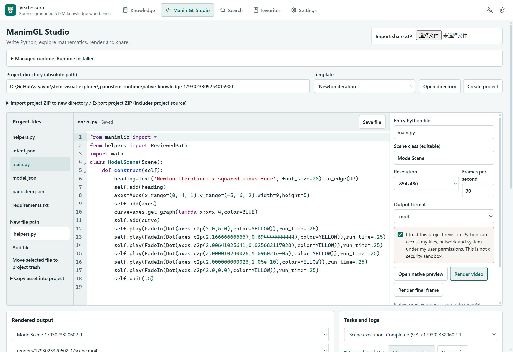
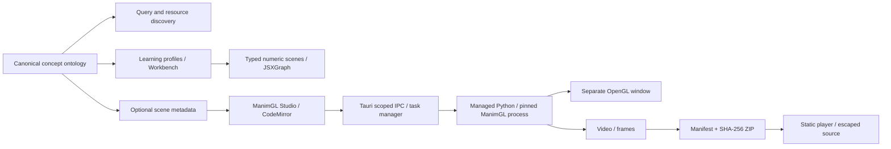

# Vextessera

Source-grounded STEM knowledge retrieval, mathematical verification, and ManimGL visualization.

[简体中文](README.zh-CN.md) · [Web app](https://styayur.github.io/vextessera/) · [Releases](https://github.com/styayur/vextessera/releases) · [ManimGL guide](docs/manimgl.md)

[](https://github.com/styayur/vextessera/actions/workflows/ci.yml)
[](https://github.com/styayur/vextessera/releases)
[](LICENSE)

**Alpha.** This source prepares **v0.6.0-alpha.1**. Download only assets actually listed in [Releases](https://github.com/styayur/vextessera/releases). Historical alpha.1/alpha.2 and stable v0.2.0 remain available with their original names and bytes. Windows x64 is the primary validated target; Linux/macOS remain experimental. The [engineering audit](docs/audits/vextessera/progress.md) separates completed checks from publication evidence and open queues.





## Capabilities

Vextessera connects a 494-concept ontology with resource discovery, learning paths, external textbook references and three guided numerical lessons: harmonic motion, ellipses and linear transformation/determinant. Search resolves English, Simplified Chinese and Traditional Chinese deterministically. JSXGraph retains numeric-only rendering, keyboard access and Reduced Motion support.

ManimGL Studio adds ordinary multi-file Python projects, five general templates and fourteen reviewed model templates, CodeMirror editing, native OpenGL previews, render tasks, logs and local share packages. Scenes may use standard ManimGL classes, custom modules, updaters and 3D cameras; no Vextessera base class or animation DSL is required.

| Capability | Static Web | Windows desktop |
| --- | --- | --- |
| Concepts, learning paths, JSXGraph lessons | Committed seven-provider snapshot | Native source adapters |
| Settings, favorites and history | Browser storage | Local SQLite/files |
| External resources | Policy-controlled cards/frames or tabs | Restricted viewers/workspaces |
| Share ZIP, metadata, source and media | Import/export and playback; no Python execution | Yes |
| Projects, editing, assets and source export | View included source only | Yes |
| Standard ManimGL preview/render, cancel and logs | No Python execution | Managed local runtime |
| Cloud renderer, accounts or database | None | None |

Try the [rendered oscillator](https://styayur.github.io/vextessera/?route=studio&example=oscillator). Share import/export is local; it neither uploads files nor creates a permanent URL.

## Architecture



The engines remain independent. Existing concept IDs are authoritative; scene metadata cannot silently create new concepts. External viewers have no app IPC or rendered-media protocol access. See [architecture](docs/architecture.md), [ADR](docs/adr/0005-panostem-manimgl.md) and [acceptance plan](docs/panostem-plan.md).

## Install and use

Download an actual Windows installer or portable ZIP from [Releases](https://github.com/styayur/vextessera/releases). Compare its full SHA-256 with that release's [SHA256SUMS.txt](https://github.com/styayur/vextessera/releases/download/v0.6.0-alpha.1/SHA256SUMS.txt) before running. Asset names are `vextessera_<version>_x64-setup.exe` and `vextessera_<version>_windows-x64.zip`. Extract portable files completely. WebView2 is required; the installer handles a missing runtime according to its configuration, while portable use needs an existing runtime. Packages are not code-signed.

Windows 11 x64 is the primary rendering/build target. The full installer upgrade lifecycle remains unverified on this host: no disposable VM/profile runner is available. For the historical product-name change, follow the [uninstall-before-install procedure](docs/migration-vextessera.md), preserving app data and external projects. Linux/macOS remain experimental without native release claims. In **ManimGL Studio**, authorize **Install / repair runtime**, then **Check environment**. Setup manages CPython **3.11.14**, uv **0.13.5** and ManimGL upstream **v1.7.2**, commit `f427fc67df75513be0cd3f3329e327a9a19401c3`. The tag's package/banner says 1.7.1; the immutable source commit identifies this runtime. Dependencies are hash-locked.

First setup needs network, user write/execute permissions and roughly 2–4 GiB free disk plus media storage. It changes neither system Python nor global PATH. Rendering needs OpenGL 3.3. FFmpeg is privately supplied by a pinned wheel; LaTeX/dvisvgm are optional for Tex objects. Native tool directories can be configured explicitly. The bundled templates require no LaTeX. See [runtime/platform details](docs/manimgl.md).

Create a template project, open an ordinary ManimGL directory, or import a project ZIP into a new directory. Edit/save source, select entry/class, review trust for the current revision, then preview or render. Native preview uses a separate window and upstream controls; IPython embed receives console line input. Render results provide playback, thumbnails, final frames and actual output paths. Tasks support bounded logs/history, cancellation and retry. Project dependencies require a separate authorization.

## Development and verification

Use Node.js **22.12+**, npm and stable Rust. Desktop builds need Tauri platform dependencies, Windows C++ tools/SDK and WebView2; see [Tauri prerequisites](https://v2.tauri.app/start/prerequisites/).

```sh
git clone https://github.com/styayur/vextessera.git
cd vextessera
npm ci
npm run dev                  # browser development, port 1420
npm run tauri -- dev         # native desktop
npm run build               # desktop frontend
npm run build:web           # static /vextessera/ deployment
npm run tauri -- build --bundles nsis
```

Static preview: `npm run preview -- --mode web`, then `http://localhost:4173/vextessera/`. `VEXTESSERA_BASE` (legacy `PANOSTEM_BASE` also accepted) overrides the static path; development/Tauri use `/`. Pages derives its base from the repository name.

```sh
npm run lint                # new Studio TypeScript/React code
npm test                    # retrieval, math, state machine, Workbench and share contracts
npx playwright install chromium
npm run test:web
npm run test:web:build
python -m unittest discover -s tests/runtime -v
cargo fmt --manifest-path src-tauri/Cargo.toml --check
cargo test --manifest-path src-tauri/Cargo.toml --no-default-features
cargo clippy --manifest-path src-tauri/Cargo.toml --no-default-features --all-targets -- -D warnings
```

The [design system](docs/design-system.md) documents shared tokens and [actual before/after captures](docs/ui-alpha2/README.md). The [release checklist](docs/release-checklist.md) records source gates, signing policy and post-publication verification.

Real runtime validation: `<runtime-python> scripts/runtime_smoke.py --runtime-root <runtime-directory>`. It renders and decodes five actual scenes, including 3D and a multi-file custom class/updater. Linux CI uses Xvfb/Mesa; runtime contracts run on Windows/Linux/macOS. `npm run test:desktop` needs the isolated profile in [functional audit setup](docs/functional-audit.md). Browser fixtures verify behavior, not third-party uptime. Real OpenGL validation is separate from mock/contract tests.

## Projects and sharing

Ordinary projects contain Python modules, assets, `custom_config.yml` and optional `requirements.txt`. Optional `panostem.json` v1 links entry scenes with concept IDs, objectives, prerequisites, sources, checkpoints and typed parameters. Parameters arrive as explicit `PANOSTEM_PARAMETERS` JSON; Python globals are not inferred as sliders.

Share ZIPs contain `manifest.json`, allowlisted media and optional selected source/notices. Entries have paths, sizes, MIME types and SHA-256. Import validates versions, traversal, symlinks, case conflicts, sizes/counts and hashes. HTML/SVG is rejected; Python is escaped text. Source is opt-in; venvs, environment files, private caches and logs are excluded. Full project export is a separate operation that explicitly includes project source/assets. See [project structure and package format](docs/manimgl.md).

## Trust, privacy and limitations

Python has the current user's file/network/system permissions. Execution trust is explicit for each canonical path/hash project revision; runs verify and execute a captured local tree, and shared source is checked against that render. Captures remain private project content, not automatic share attachments; dependency installation has a separate grant. Venvs, AST inspection, child processes and Job Objects are **not security sandboxes**. Windows Job Objects/Unix process groups manage lifetime; secrets and proxy credentials are not inherited. App-managed tasks have one-hour timeouts, bounded logs/history and explicit render cleanup. Arbitrary Python can write outside those limits.

Experimental Windows Sandbox export creates a separate VM configuration with network/clipboard disabled and read-only inputs; vGPU and a dedicated writable output folder remain shared. That OS component is absent on the local test host, so VM execution/GPU compatibility is unverified. Use disposable OS isolation for unknown code. Ordinary Run buttons do not provide it.

The application has no accounts, telemetry or cloud database. User Python/dependencies can make their own network requests. Desktop discovery contacts sources; Web uses a committed seven-provider snapshot (1,555 entries). Translation is off by default; enabling it sends non-glossary text to MyMemory, and configured proxies receive page requests. External sources/snapshots can fail or become stale. CSP/X-Frame-Options, login and anti-bot restrictions are not bypassed. The app is not an installable offline PWA; reopening offline depends on browser asset caching. MOV playback depends on codecs; MP4 is the preferred share format. See [SECURITY.md](SECURITY.md).

## Migration, license and contribution

Vextessera follows **STEM Visual Explorer → Panostem → Vextessera**. The Tauri identifier, SQLite path, browser keys and version-one project/share protocols remain unchanged. Read [migration and installation limits](docs/migration-vextessera.md). The target Web path is `https://styayur.github.io/vextessera/`; actual new/old HTTP results are recorded after deployment. Historical release/audit documents keep their original identity.

Application source remains [AGPL-3.0-only](LICENSE). ManimGL and CodeMirror are MIT; downloaded Python/native libraries retain their licenses. Actual inventories and notice texts are included in `licenses/` and summarized in [THIRD_PARTY_NOTICES.md](THIRD_PARTY_NOTICES.md). The app license does not automatically determine rights in user scenes, videos, textbooks or external assets.

Next work includes wider native-platform validation, stronger OS isolation, editor tooling and provider/index maintenance. Read [CONTRIBUTING.md](CONTRIBUTING.md), report reproducible [Issues](https://github.com/styayur/vextessera/issues), and use private security reporting for vulnerabilities. Releases follow protected PRs, successful checks, real binaries and per-asset checksums.
## Sources, mathematical models and batch processing

The Knowledge workspace can read local scientific documents without executing
their code or uploading their contents. It exposes source positions, formulas,
canonical concept links and honest review states. The reproducible source census,
reviewed mathematical recipes and checkpointed corpus ledger are documented in
[the knowledge pipeline guide](docs/knowledge-pipeline.md).

The full discovered corpus is classified: **22 sources**, **18,402 records**,
**13,977 units**, **16 verified scene associations**. There are **5,765** units
requiring modeling and **8,196** requiring review; no unit in this run remains
`not-yet-processed`. Classification is not completed visualization. See the machine-readable [source report](docs/audits/vextessera/source-census.json).

Fourteen source-grounded models expose equations, units, assumptions and independent
verification. Six cleared self-rendered movies and ordinary source share packages
play in Web; all fourteen templates open in native Studio with revision trust.

Twelve of fifteen specified Git repositories were available as verified local clones;
three original identities remain unavailable. The seven-provider static snapshot
contains 1,555 linked resources. A [source-by-source report](docs/audits/vextessera/sources.md)
records counts, formats, license evidence and remaining actions. Public distribution
includes no private corpus or third-party bodies/images. PhET regular HTML simulations
have CC BY-NC 4.0 terms; NC/SA and unclear grants remain outside our public media.

Models record domains, units, assumptions, equations, parameters, conditions and
invariants. Symbolic identities, analytical solutions, numerical reference methods
and convergence checks accompany actual renders. The beam formula was manually
reviewed from one exact PDF page/row; this is not general PDF parsing. The PID
plant/controller are explicitly application-authored assumptions. Batch commands
support filters, content hashes, limits, checkpoints, retries and cancellation.
Whole-site discovery and per-source modeling remain open work; the corpus report's
`releaseReady:false` describes that unfinished visualization scope.
