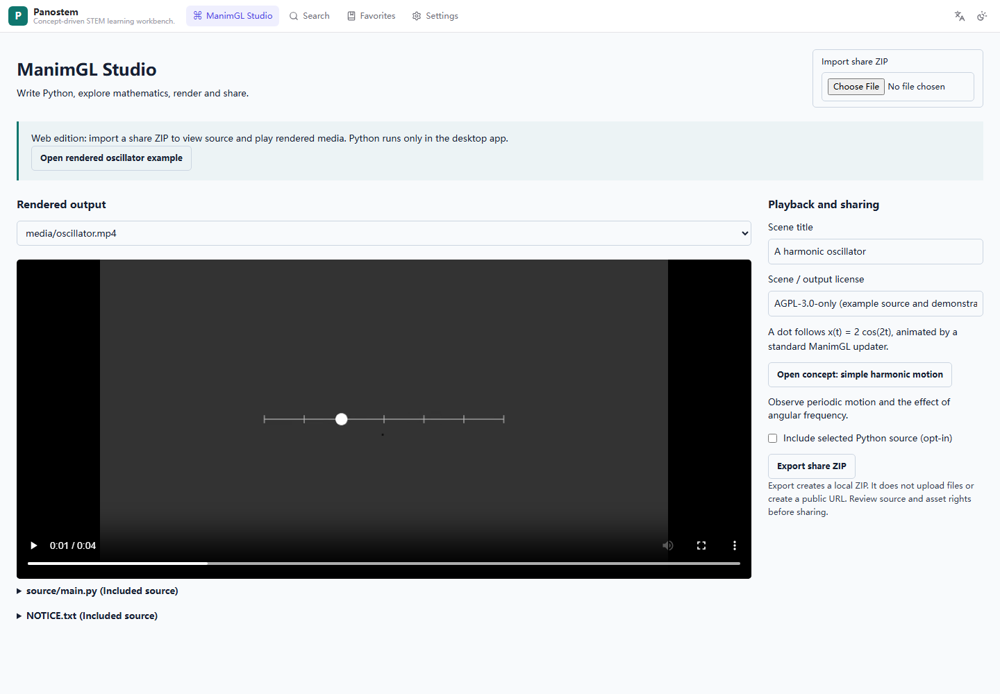
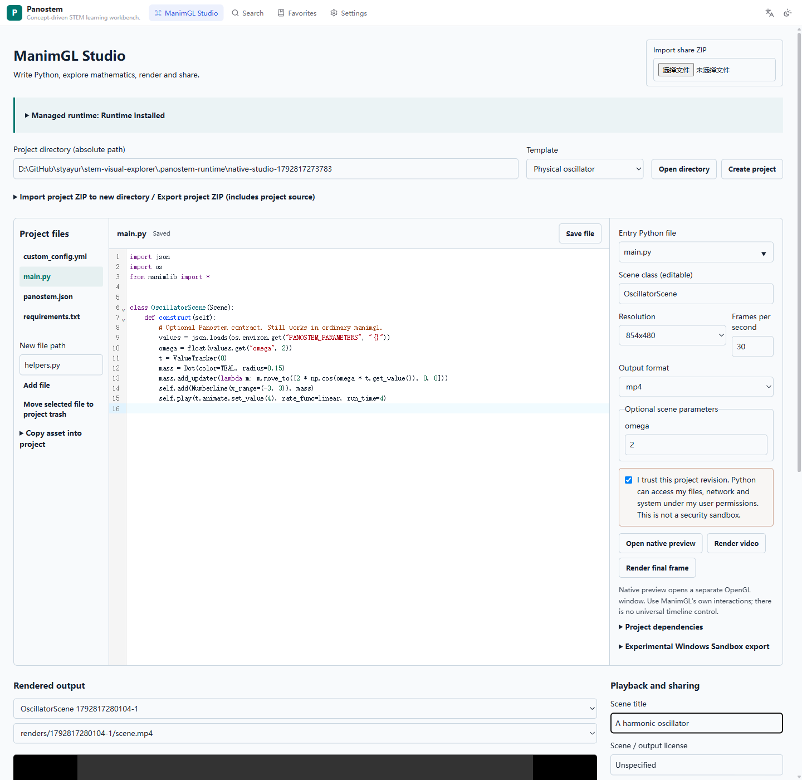
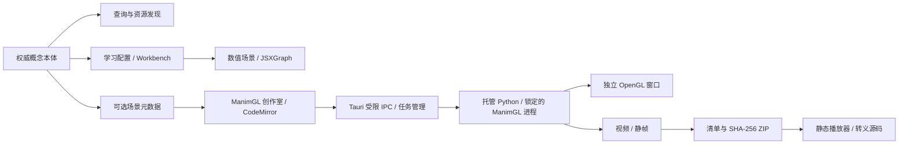

# Panostem

以概念为核心的 STEM 学习环境，支持原生 ManimGL 场景创作与渲染。

[English](README.md) · [网页版](https://styayur.github.io/panostem/) · [版本发布](https://github.com/styayur/panostem/releases) · [ManimGL 指南](docs/manimgl.md)

[](https://github.com/styayur/panostem/actions/workflows/ci.yml)
[](https://github.com/styayur/panostem/releases)
[](LICENSE)

**Alpha。** 当前源码版本为 **0.5.0-alpha.1**，ManimGL 集成仍属实验阶段。历史最新稳定 Windows 版本为 [v0.2.0](https://github.com/styayur/panostem/releases/tag/v0.2.0)，不包含此后新增的创作室与引导课程。实际测试、资产和部署状态见[交付审计](docs/audits/panostem-delivery.md)。





## 产品能力

Panostem 将 490 个概念的本体与资源发现、学习路径、外部教材引用和三套引导课程连接起来：简谐振动、椭圆、线性变换与行列式。检索使用确定性的概念解析，支持英语、简体中文和繁体中文。JSXGraph 保留数值图元边界、键盘操作和 Reduced Motion 支持。

ManimGL 创作室提供普通多文件 Python 项目、五类模板、CodeMirror 编辑器、原生 OpenGL 预览、渲染任务、日志与本地分享包。可使用标准 ManimGL 类、自定义模块、updater 和三维相机，无需继承专有基类或转换成动画 DSL。

| 能力 | 静态网页版 | Windows 桌面版 |
| --- | --- | --- |
| 概念、学习路径、JSXGraph 课程 | 已提交的七来源快照 | 原生来源适配器 |
| 设置、收藏、历史 | 浏览器存储 | 本地 SQLite / 文件 |
| 外部资源 | 按策略使用卡片、嵌入或标签 | 受限原生窗口与工作区 |
| 分享 ZIP、元数据、源码与媒体 | 导入导出和播放，不执行 Python | 支持 |
| 项目、编辑、素材与源码导出 | 仅查看所含源码 | 支持 |
| 标准 ManimGL 预览/渲染、取消与日志 | 不执行 Python | 托管本地运行时 |
| 云渲染、账号或数据库 | 无 | 无 |

可打开[已渲染振子示例](https://styayur.github.io/panostem/?route=studio&example=oscillator)。分享包导入导出在本地完成，不上传文件，也不自动生成永久公开网址。

## 核心架构



两套引擎保持独立，现有 Concept ID 是身份权威，场景元数据不静默生成新概念。外部窗口无应用 IPC 或渲染媒体协议权限。参见[架构](docs/architecture.md)、[ADR](docs/adr/0005-panostem-manimgl.md)和[验收计划](docs/panostem-plan.md)。

## 安装与使用

从 [Releases](https://github.com/styayur/panostem/releases) 下载实际存在的 Windows 安装器或便携 ZIP，运行前对照该版本的 `SHA256SUMS.txt` 核查完整 SHA-256。资产命名为 `panostem_<version>_x64-setup.exe` 和 `panostem_<version>_windows-x64.zip`。便携包需完整解压。桌面版需要 WebView2；安装器按其配置处理缺失运行时，便携版需要已有运行时。安装包未进行代码签名。

Windows 11 x64 是主要已验证目标；Linux/macOS 为实验状态，不宣称提供正式原生发布。在 **ManimGL 创作室**授权**安装 / 修复运行时**，再**检查环境**。安装器管理 CPython **3.11.14**、uv **0.13.5** 和 ManimGL 上游 **v1.7.2** 的不可变提交 `f427fc67df75513be0cd3f3329e327a9a19401c3`。该 tag 的包元数据与启动横幅显示 1.7.1，应以源码提交识别运行时。依赖带哈希锁定。

首次配置需要网络、用户写入/执行权限、约 2–4 GiB 可用磁盘及额外媒体空间，不修改系统 Python 或全局 PATH。渲染需要 OpenGL 3.3。FFmpeg 由固定 wheel 提供并仅加入子进程私有 PATH；Tex 对象可选依赖 LaTeX/dvisvgm，可显式配置原生工具目录。五类模板无需 LaTeX。详见[运行时与平台指南](docs/manimgl.md)。

从模板创建项目、打开普通 ManimGL 目录，或将项目 ZIP 导入新目录。编辑保存源码、选择入口和场景、审阅当前版本信任提示，然后预览或渲染。原生预览使用独立窗口和上游交互；IPython embed 可接收控制台行输入。产物支持应用内播放、缩略图、最终帧和真实路径。任务支持有界日志/历史、取消与重试。项目依赖需单独授权。

## 本地开发与验证

需要 Node.js **22.12+**、npm 和稳定版 Rust。桌面构建还需要 Tauri 平台依赖、Windows C++ 工具/SDK 与 WebView2；参见 [Tauri 前置条件](https://v2.tauri.app/start/prerequisites/)。

```sh
git clone https://github.com/styayur/panostem.git
cd panostem
npm ci
npm run dev                  # 浏览器开发，端口 1420
npm run tauri -- dev         # 原生桌面
npm run build               # 桌面前端
npm run build:web           # 静态 /panostem/ 部署
npm run tauri -- build --bundles nsis
```

静态预览：`npm run preview -- --mode web`，打开 `http://localhost:4173/panostem/`。`PANOSTEM_BASE` 可覆盖静态路径；开发/Tauri 使用 `/`。Pages 工作流按仓库名生成部署路径。

```sh
npm run lint                # 新增 Studio TypeScript/React 代码
npm test                    # 检索、数学、状态机、Workbench 与分享契约
npx playwright install chromium
npm run test:web
npm run test:web:build
python -m unittest discover -s tests/runtime -v
cargo fmt --manifest-path src-tauri/Cargo.toml --check
cargo test --manifest-path src-tauri/Cargo.toml --no-default-features
cargo clippy --manifest-path src-tauri/Cargo.toml --no-default-features --all-targets -- -D warnings
```

真实验证：`<runtime-python> scripts/runtime_smoke.py --runtime-root <runtime-directory>`，实际渲染并解码五类场景，包括三维与多文件自定义类/updater。Linux CI 使用 Xvfb/Mesa，Windows/Linux/macOS 执行运行时契约。`npm run test:desktop` 需要[功能审计](docs/functional-audit.md)规定的独立配置。浏览器固定响应验证应用行为，不代表第三方服务在线。真实 OpenGL 验证与模拟/契约测试分别记录。

## 项目与分享格式

普通项目包含 Python 模块、素材、`custom_config.yml` 和可选 `requirements.txt`。可选的 `panostem.json` v1 将入口场景与概念、目标、先修关系、来源、检查点和类型化参数关联。参数通过显式 `PANOSTEM_PARAMETERS` JSON 传入，不自动将 Python 全局变量转成滑块。

分享 ZIP 包含 `manifest.json`、白名单媒体与可选的选中源码/声明。每个文件记录路径、大小、MIME 和 SHA-256。导入校验版本、目录穿越、符号链接、大小写冲突、数量、大小和哈希。拒绝 HTML/SVG，Python 仅显示为转义文本。源码默认不包含，不自动收集虚拟环境、环境文件、私有缓存或日志。完整项目导出是另一个明确包含项目源码与素材的操作。项目结构与格式详见[指南](docs/manimgl.md)。

## 信任、安全与隐私

Python 具有当前用户的文件、网络和系统权限。执行授权绑定项目版本，依赖安装另行授权。虚拟环境、AST 检查、子进程和 Job Object **不是安全沙箱**。Windows Job Object / Unix 进程组管理生命周期，不继承密钥和代理凭据。应用任务有一小时超时、有界日志/历史和显式渲染清理；任意 Python 自身仍可写入限制之外的位置。

实验性 Windows Sandbox 导出生成独立虚拟环境配置：禁用网络/剪贴板，输入只读，但共享 vGPU 和专用可写输出目录。本机未启用该系统组件，虚拟机执行和 GPU 兼容性未验证。未知代码应使用可丢弃的操作系统隔离环境，普通运行按钮不提供此隔离。

应用无账号、遥测或云数据库；用户 Python/依赖仍可自行联网。桌面发现直接访问来源；Web 使用七来源、1,079 条已提交快照。翻译默认关闭，启用后非词表文本发往 MyMemory，配置的代理也会接收页面请求。外部内容与快照可能失效或过时，不绕过 CSP/X-Frame-Options、登录或反机器人限制。应用不是可安装离线 PWA，离线重新打开取决于浏览器缓存。MOV 播放受编解码器限制，分享优先使用 MP4。参见[安全政策](SECURITY.md)。

## 品牌迁移、许可与贡献

Panostem 替换原 STEM Visual Explorer 公开名称，Tauri 标识和旧存储键保持不变，以兼容数据。仓库链接与 Pages 跳转行为不同，[迁移说明](docs/migration-panostem.md)和交付审计记录实际新旧地址结果。不修改其他仓库、个人网站或 DNS。

应用源码保持 [AGPL-3.0-only](LICENSE)。ManimGL 与 CodeMirror 使用 MIT，下载的 Python/原生依赖保留各自许可。实际清单与声明文本位于 `licenses/`，摘要见[第三方声明](THIRD_PARTY_NOTICES.md)。应用许可不会自动决定用户场景、视频、教材或外部素材的权利。

后续工作包括更多原生平台验证、更强的操作系统隔离、编辑工具与来源/索引维护。请阅读 [CONTRIBUTING.md](CONTRIBUTING.md)，通过 [Issues](https://github.com/styayur/panostem/issues) 提供可复现问题；漏洞走私密渠道。发布遵循受保护 PR、真实成功检查、实际二进制和逐资产校验。
