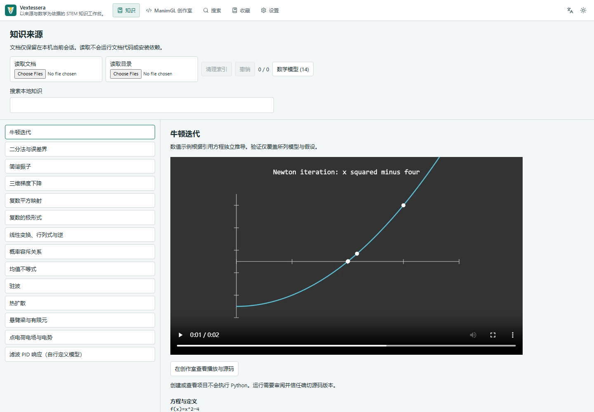
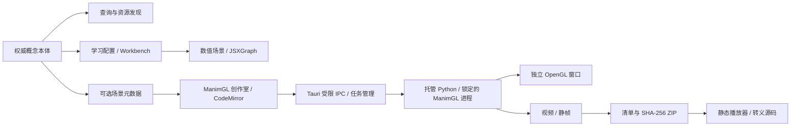

# Vextessera

以知识来源为依据的 STEM 检索、数学验证与 ManimGL 可视化环境。

[English](README.md) · [网页版](https://styayur.github.io/vextessera/) · [版本发布](https://github.com/styayur/vextessera/releases) · [ManimGL 指南](docs/manimgl.md)

[](https://github.com/styayur/vextessera/actions/workflows/ci.yml)
[](https://github.com/styayur/vextessera/releases)
[](LICENSE)

**Alpha。** 当前预发布版本为 **[v0.6.0-alpha.1](https://github.com/styayur/vextessera/releases/tag/v0.6.0-alpha.1)**。Windows 安装器、便携包及公开下载的 SHA-256 已实际核验；[发布审计](docs/audits/vextessera/publication.md)记录源码／流程提交、检查、资产、Pages 和剩余限制。历史 v0.5.0-alpha.1、v0.5.0-alpha.2 和 v0.2.0 保留原名称及字节。Windows x64 是主要验证目标，Linux/macOS 仍为实验状态。




## 产品能力

Vextessera 将 494 个概念的本体与资源发现、学习路径、外部教材引用和三套引导课程连接起来：简谐振动、椭圆、线性变换与行列式。检索使用确定性的概念解析，支持英语、简体中文和繁体中文。JSXGraph 保留数值图元边界、键盘操作和 Reduced Motion 支持。

ManimGL 创作室提供普通多文件 Python 项目、五类模板、CodeMirror 编辑器、原生 OpenGL 预览、渲染任务、日志与本地分享包。可使用标准 ManimGL 类、自定义模块、updater 和三维相机，无需继承专有基类或转换成动画 DSL。

| 能力 | 静态网页版 | Windows 桌面版 |
| --- | --- | --- |
| 概念、学习路径、JSXGraph 课程 | 已提交的七来源快照 | 原生来源适配器 |
| 设置、收藏、历史 | 浏览器存储 | 本地 SQLite / 文件 |
| 外部资源 | 按策略使用卡片、嵌入或标签 | 受限原生窗口与工作区 |
| 分享 ZIP、元数据、源码与媒体 | 导入导出和播放，不执行 Python | 支持 |
| 项目、编辑、素材与源码导出 | 仅查看所含源码 | 支持 |
| 标准 ManimGL 预览/渲染、取消与日志 | 不执行 Python | 托管本地运行时 |
| 云渲染、账号或数据库 | 无 | 无 |

可打开[已渲染振子示例](https://styayur.github.io/vextessera/?route=studio&example=oscillator)。分享包导入导出在本地完成，不上传文件，也不自动生成永久公开网址。

## 核心架构



两套引擎保持独立，现有 Concept ID 是身份权威，场景元数据不静默生成新概念。外部窗口无应用 IPC 或渲染媒体协议权限。参见[架构](docs/architecture.md)、[ADR](docs/adr/0005-panostem-manimgl.md)和[验收计划](docs/panostem-plan.md)。

## 安装与使用

从 [Releases](https://github.com/styayur/vextessera/releases) 下载实际存在的 Windows 安装器或便携 ZIP，运行前对照该版本的 [SHA256SUMS.txt](https://github.com/styayur/vextessera/releases/download/v0.6.0-alpha.1/SHA256SUMS.txt) 核查完整 SHA-256。资产命名为 `vextessera_<version>_x64-setup.exe` 和 `vextessera_<version>_windows-x64.zip`。便携包需完整解压。桌面版需要 WebView2；安装器按其配置处理缺失运行时，便携版需要已有运行时。安装包未进行代码签名。

Windows 11 x64 是主要渲染与构建目标；Linux/macOS 为实验状态，不宣称提供正式原生发布。在 **ManimGL 创作室**授权**安装 / 修复运行时**，再**检查环境**。安装器管理 CPython **3.11.14**、uv **0.13.5** 和 ManimGL 上游 **v1.7.2** 的不可变提交 `f427fc67df75513be0cd3f3329e327a9a19401c3`。该 tag 的包元数据与启动横幅显示 1.7.1，应以源码提交识别运行时。依赖带哈希锁定。

首次配置需要网络、用户写入/执行权限、约 2–4 GiB 可用磁盘及额外媒体空间，不修改系统 Python 或全局 PATH。渲染需要 OpenGL 3.3。FFmpeg 由固定 wheel 提供并仅加入子进程私有 PATH；Tex 对象可选依赖 LaTeX/dvisvgm，可显式配置原生工具目录。五类模板无需 LaTeX。详见[运行时与平台指南](docs/manimgl.md)。

从模板创建项目、打开普通 ManimGL 目录，或将项目 ZIP 导入新目录。编辑保存源码、选择入口和场景、审阅当前版本信任提示，然后预览或渲染。原生预览使用独立窗口和上游交互；IPython embed 可接收控制台行输入。产物支持应用内播放、缩略图、最终帧和真实路径。任务支持有界日志/历史、取消与重试。项目依赖需单独授权。

本机没有可用的一次性虚拟机或独立 Windows 配置文件运行环境，完整安装升级生命周期尚未验证。跨历史产品名安装请遵循[先卸载后安装流程](docs/migration-vextessera.md)，保留应用数据和外部项目。运行采用规范的路径/哈希清单，先验证捕获的本地项目树再启动引擎；分享源码也与该次渲染清单核对。捕获目录仍可能含有私有项目内容，不会自动加入分享包。

[设计系统](docs/design-system.md)说明共享令牌和[真实改版前后截图](docs/ui-alpha2/README.md)；[发布检查表](docs/release-checklist.md)记录源码门禁、签名策略与发布后验证。规范 Web 地址为 https://styayur.github.io/vextessera/；历史 Pages 路径返回 404，并不重定向。

## 本地开发与验证

需要 Node.js **22.12+**、npm 和稳定版 Rust。桌面构建还需要 Tauri 平台依赖、Windows C++ 工具/SDK 与 WebView2；参见 [Tauri 前置条件](https://v2.tauri.app/start/prerequisites/)。

```sh
git clone https://github.com/styayur/vextessera.git
cd vextessera
npm ci
npm run dev                  # 浏览器开发，端口 1420
npm run tauri -- dev         # 原生桌面
npm run build               # 桌面前端
npm run build:web           # 静态 /vextessera/ 部署
npm run tauri -- build --bundles nsis
```

静态预览：`npm run preview -- --mode web`，打开 `http://localhost:4173/vextessera/`。`VEXTESSERA_BASE`（仍兼容旧 `PANOSTEM_BASE`） 可覆盖静态路径；开发/Tauri 使用 `/`。Pages 工作流按仓库名生成部署路径。

```sh
npm run lint                # 新增 Studio TypeScript/React 代码
npm test                    # 检索、数学、状态机、Workbench 与分享契约
npx playwright install chromium
npm run test:web
npm run test:web:build
python -m unittest discover -s tests/runtime -v
cargo fmt --manifest-path src-tauri/Cargo.toml --check
cargo test --manifest-path src-tauri/Cargo.toml --no-default-features
cargo clippy --manifest-path src-tauri/Cargo.toml --no-default-features --all-targets -- -D warnings
```

真实验证：`<runtime-python> scripts/runtime_smoke.py --runtime-root <runtime-directory>`，实际渲染并解码五类场景，包括三维与多文件自定义类/updater。Linux CI 使用 Xvfb/Mesa，Windows/Linux/macOS 执行运行时契约。`npm run test:desktop` 需要[功能审计](docs/functional-audit.md)规定的独立配置。浏览器固定响应验证应用行为，不代表第三方服务在线。真实 OpenGL 验证与模拟/契约测试分别记录。

## 项目与分享格式

普通项目包含 Python 模块、素材、`custom_config.yml` 和可选 `requirements.txt`。可选的 `panostem.json` v1 将入口场景与概念、目标、先修关系、来源、检查点和类型化参数关联。参数通过显式 `PANOSTEM_PARAMETERS` JSON 传入，不自动将 Python 全局变量转成滑块。

分享 ZIP 包含 `manifest.json`、白名单媒体与可选的选中源码/声明。每个文件记录路径、大小、MIME 和 SHA-256。导入校验版本、目录穿越、符号链接、大小写冲突、数量、大小和哈希。拒绝 HTML/SVG，Python 仅显示为转义文本。源码默认不包含，不自动收集虚拟环境、环境文件、私有缓存或日志。完整项目导出是另一个明确包含项目源码与素材的操作。项目结构与格式详见[指南](docs/manimgl.md)。

## 信任、安全与隐私

Python 具有当前用户的文件、网络和系统权限。执行授权绑定项目版本，依赖安装另行授权。虚拟环境、AST 检查、子进程和 Job Object **不是安全沙箱**。Windows Job Object / Unix 进程组管理生命周期，不继承密钥和代理凭据。应用任务有一小时超时、有界日志/历史和显式渲染清理；任意 Python 自身仍可写入限制之外的位置。

实验性 Windows Sandbox 导出生成独立虚拟环境配置：禁用网络/剪贴板，输入只读，但共享 vGPU 和专用可写输出目录。本机未启用该系统组件，虚拟机执行和 GPU 兼容性未验证。未知代码应使用可丢弃的操作系统隔离环境，普通运行按钮不提供此隔离。

应用无账号、遥测或云数据库；用户 Python/依赖仍可自行联网。桌面发现直接访问来源；Web 使用七来源、1,555 条已提交快照。翻译默认关闭，启用后非词表文本发往 MyMemory，配置的代理也会接收页面请求。外部内容与快照可能失效或过时，不绕过 CSP/X-Frame-Options、登录或反机器人限制。应用不是可安装离线 PWA，离线重新打开取决于浏览器缓存。MOV 播放受编解码器限制，分享优先使用 MP4。参见[安全政策](SECURITY.md)。

## 品牌迁移、许可与贡献

Vextessera 替换原 STEM Visual Explorer 公开名称，Tauri 标识和旧存储键保持不变，以兼容数据。仓库链接与 Pages 跳转行为不同，[迁移说明](docs/migration-vextessera.md)和交付审计记录实际新旧地址结果。不修改其他仓库、个人网站或 DNS。

应用源码保持 [AGPL-3.0-only](LICENSE)。ManimGL 与 CodeMirror 使用 MIT，下载的 Python/原生依赖保留各自许可。实际清单与声明文本位于 `licenses/`，摘要见[第三方声明](THIRD_PARTY_NOTICES.md)。应用许可不会自动决定用户场景、视频、教材或外部素材的权利。

后续工作包括更多原生平台验证、更强的操作系统隔离、编辑工具与来源/索引维护。请阅读 [CONTRIBUTING.md](CONTRIBUTING.md)，通过 [Issues](https://github.com/styayur/vextessera/issues) 提供可复现问题；漏洞走私密渠道。发布遵循受保护 PR、真实成功检查、实际二进制和逐资产校验。
## 知识来源、数学模型与批处理

知识工作区可以在本机读取科学文档，查看来源位置、公式、权威概念关联和待审阅状态，
不会运行文档代码或上传正文。可复现的来源普查、经过验证的数学场景和断点批处理台账
见[知识可视化管线说明](docs/knowledge-pipeline.md)。

本阶段不宣称全量语料已完成可视化。实际发布状态以版本页及发布审计为准。
实际数量及限制见[机器可读来源报告](docs/audits/vextessera/source-census.json)。

十四个可追溯模型提供公式、单位、假设和独立验证结果。Web 可播放六个已完成许可核对的自制场景并下载普通源码分享包；十四个模板均可在桌面创作室中创建项目，运行前仍须信任具体版本。

本轮逐项分类覆盖 **22 个来源、18,402 个文件／资源、13,977 个知识单元**。
十四个独立场景形成十六个验证关联，仍有 **5,765** 个单元需要建模、
**8,196** 个需要审阅，已发现单元的未处理数为零。这不表示所有资源都已生成视频，
也不证明网站所有未链接页面均已发现。详见[逐来源清单](docs/audits/vextessera/sources.md)。
十五个原始 Git 来源中十二个本地克隆通过核对，三个不可用来源保留原身份。
七网站静态快照现有 1,555 项。

模型记录定义域、单位、公式、参数、假设、初边值条件和不变量，并通过符号、解析、
独立数值参考或收敛测试验证。梁模型来自一个精确 PDF 页／行的人工复核，
不代表通用 PDF 解析；PID 的对象和控制律明确为应用自行定义。批处理支持筛选、
内容哈希、并发限制、断点、重试与取消。`releaseReady:false` 指全语料可视化仍未完成。

公开媒体仅含六个完成许可核对的自制场景，不含第三方正文、图片或私人索引。
PhET 常规 HTML 仿真采用 CC BY-NC 4.0；其他 NC/SA、教材扫描件和许可不明确内容
保留外部引用或本地使用模式。更名沿 **STEM Visual Explorer → Panostem → Vextessera**
保留应用 ID、SQLite、浏览器键及原项目／分享格式，见[迁移说明](docs/migration-vextessera.md)。
